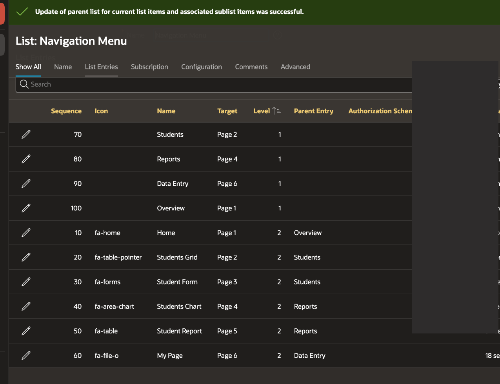
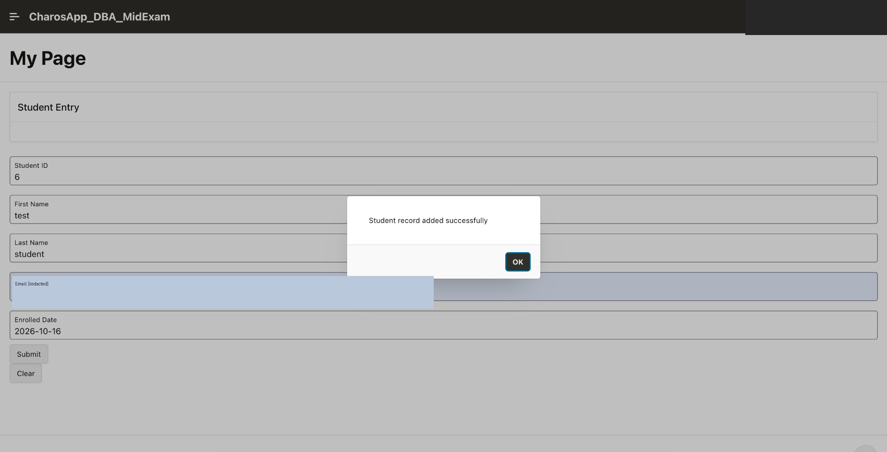
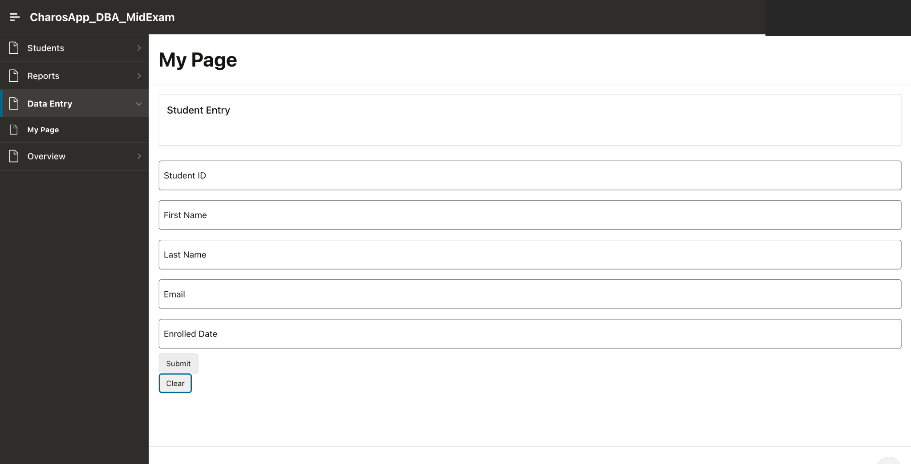
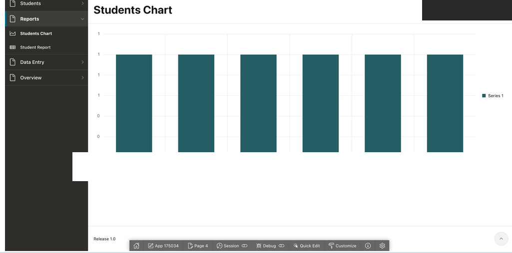
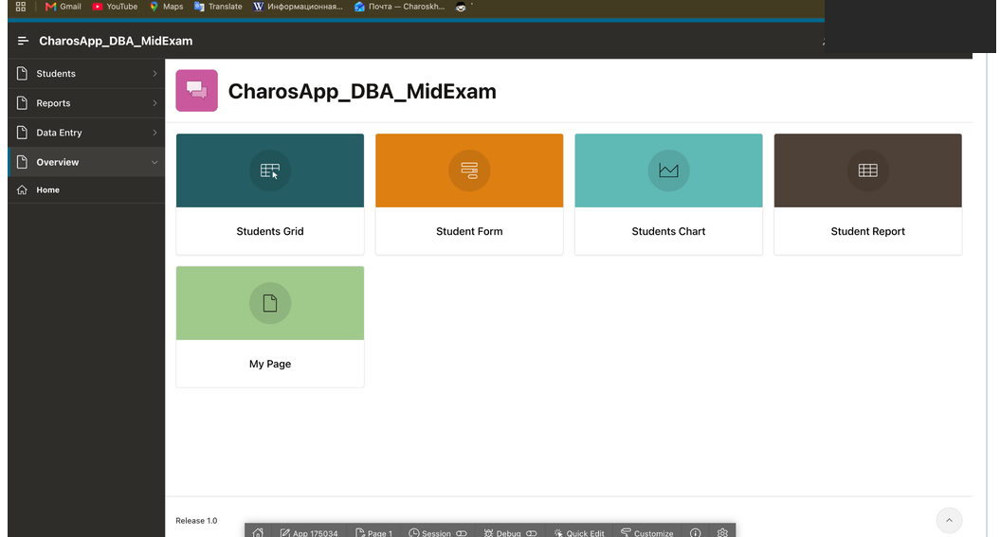

# Student Management Application | Oracle APEX

**University project | Webster University in Tashkent | Database Applications Midterm | October 2026**

**Author:** Charoskhon Farkhadova  
**Platform:** Oracle APEX (Oracle Database)  
**Project type:** Academic low-code database application

## Overview

This project documents an Oracle APEX application created for an academic database applications assessment. It demonstrates a student data entry workflow and an organized interface with data grids, reports, charts, and navigation pages.

This repository includes **sanitized screenshots and project documentation**. It does **not** contain an Oracle APEX application export or a runnable application. Features described below are supported by the original coursework evidence.

## Features

- **Student Entry Form:** fields for Student ID, First Name, Last Name, Email, and Enrolled Date.
- **Create / Submit workflow:** a successful submission confirmation after adding a test record.
- **Clear action:** resets the five entry fields for new data.
- **Four main navigation sections:** Students, Reports, Data Entry, and Overview, with nested pages.
- **Student Grid and Student Report:** tabular views of student records.
- **Students Chart:** basic graphical display of student data.
- **Home dashboard:** entry points to the main application pages.

## Screenshots

**Navigation menu**

**Successful record insert**

**Cleared data entry form**

**Students chart**

**Home dashboard**

## Project documentation

See [Feature walkthrough and implementation notes](docs/project-notes.md) for the documented page structure, evidence, and limits.

## Skills demonstrated

Oracle APEX, Oracle Database fundamentals, Database Applications, Low-Code Development, Form Design, CRUD workflows, Interactive Reports, Data Visualization, Application Navigation, Test Evidence.

## Privacy and scope

Original screenshots contained account identifiers and example email addresses; public portfolio images have been cropped/redacted. No university login credentials, live session URLs, or actual student contact details are intentionally included.

**Future improvement:** export the original application from a permitted Oracle APEX workspace, review and sanitize it, and publish import instructions. The supplied files currently serve as a verified portfolio case study rather than source code.

---

[GitHub Profile](https://github.com/requiembby) · [LinkedIn](https://www.linkedin.com/in/charoskhon-farkhadova-2148a9307/)